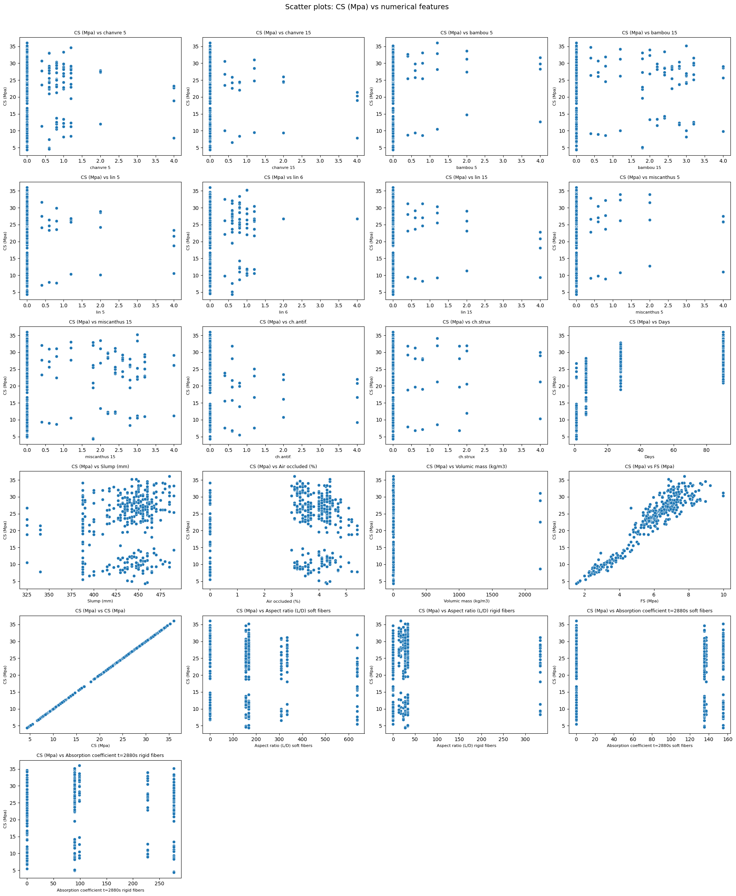
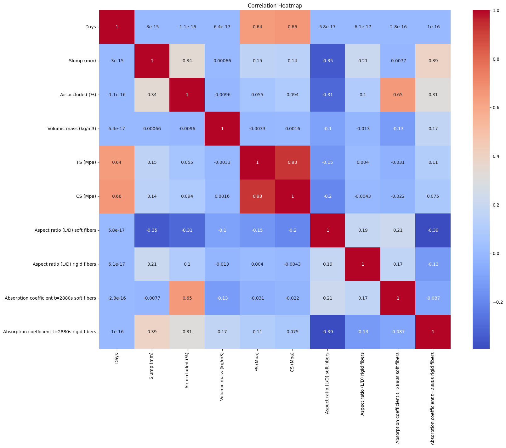
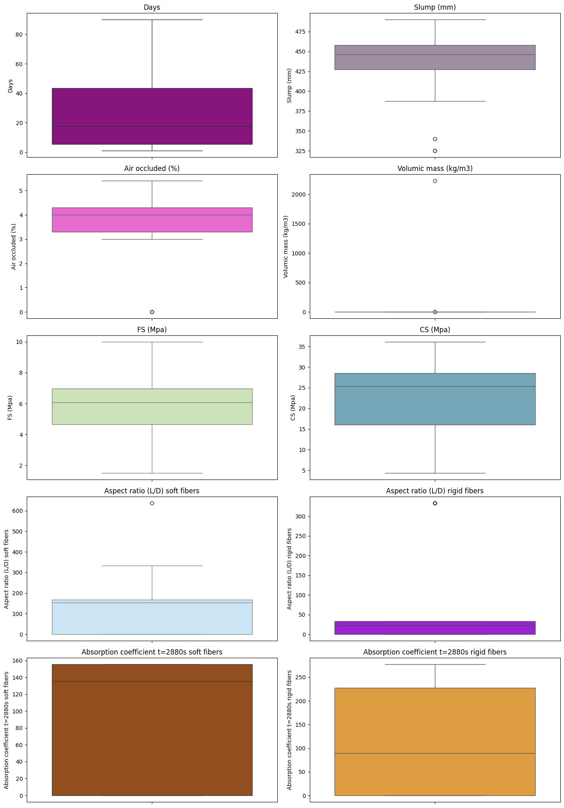
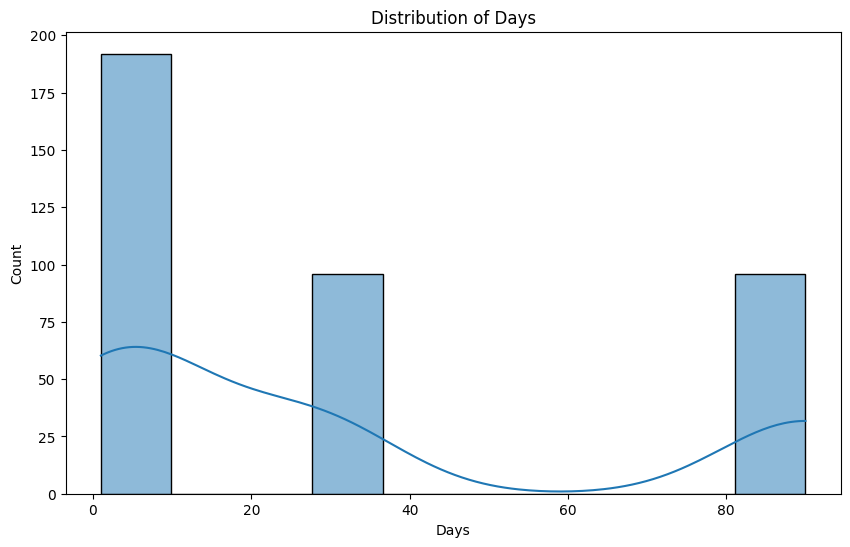

## Data analysis 
- Objective : The objective of this analysis is to identify the relationships between the different features of the dataset and to understand how they affect the target variable.
- 1. Linear correlation with pairplot (desc / figure)

- 2. Pearson correlation matrix for analyzed SFRC features and its CS (Desc and Figure)

- 3. Outliers :
    - Question : Volumic Mass / Air occluded à 0 ? Normal ?  

- 4. Distribution of fiber Type + distriubtion of currint time + Days distribution

