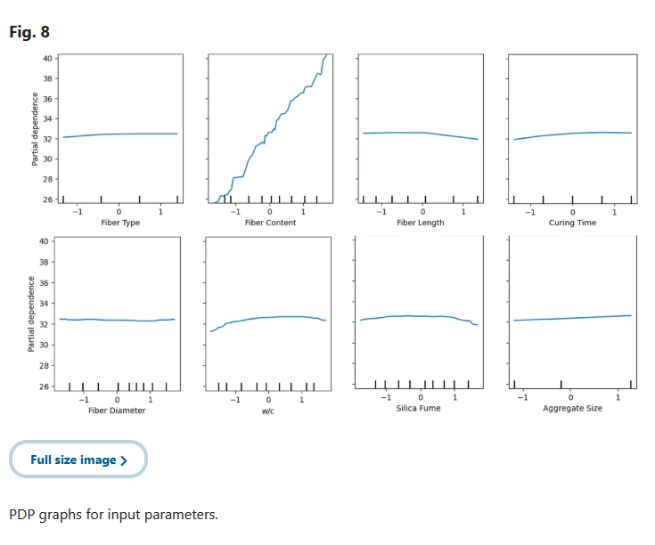

### Résultat :

- ?. PDPs faire varier des  features afin d'estimer leur importances sur le modèle

- Results and Comparison : 

    - Graphique with : ERROR / Measured / Algo (ANN/XGBOOST/RANDOM_F)

    -  Linear regression / Tab récapitulatif

    - Different fold with KNN different fold 1 / 2 / ... 

    - RMSE / R2 by fold 1 / 2 / ...

